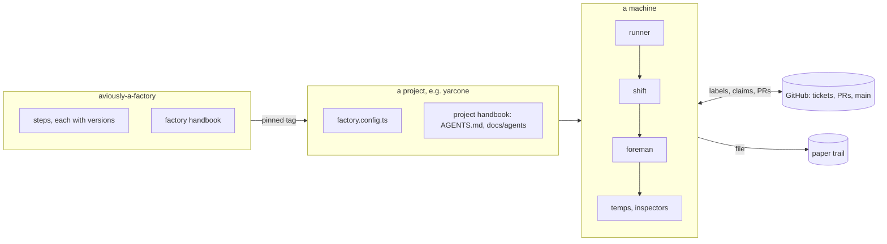
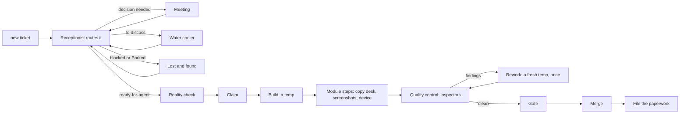
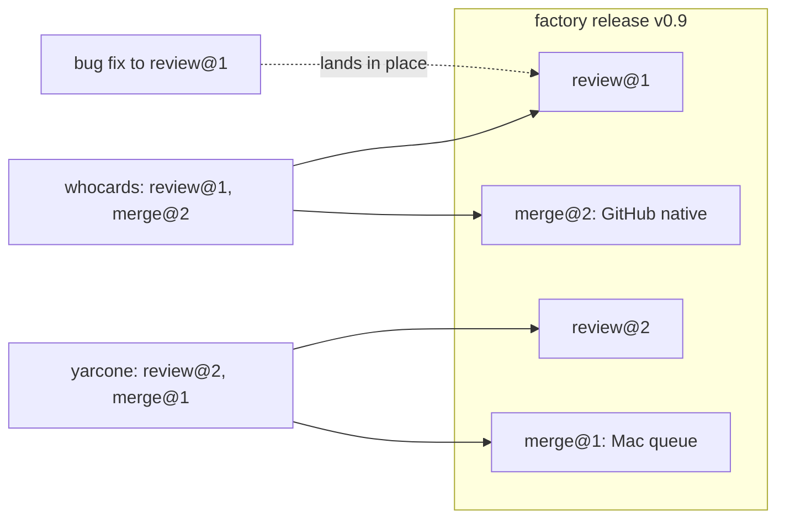
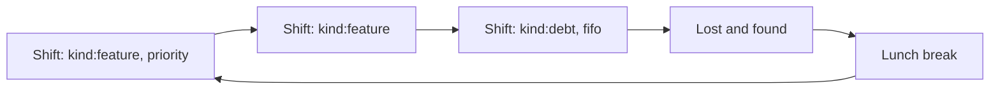
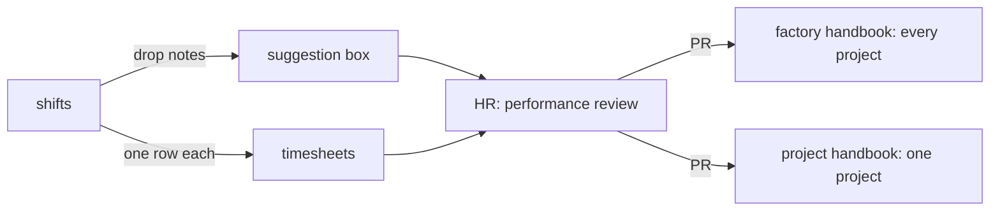

# How it works

Tickets go in, merged PRs come out. A person shows up only for decisions.

Five ideas, one paragraph each:

1. **A ticket walks through steps.** Each step reads GitHub, does one thing, and leaves GitHub changed for the next one.
2. **Steps are replaceable parts.** Each project picks a version per step, like `review@2`. A fix to a version reaches every project using it.
3. **A shift is "which tickets, how watched, in what order".** A rota is the list of shifts a machine works through.
4. **People get meetings, not pings.** Anything only a person can decide waits in a meeting, a water cooler thread, or lost and found.
5. **The factory keeps receipts and reviews itself.** Shifts leave timesheets, memos and suggestions. HR reads the suggestions and proposes handbook changes as a PR.

## The big picture

## A ticket's journey

Every arrow is a change on GitHub: a label, a claim comment, a branch, a PR, a status. That is why any box can be swapped out, and why a crashed shift resumes at the first box whose output is missing.

## Steps and versions

New behaviour gets a new number. Fixes don't. An old number is deprecated before it is removed. See [ADR 0001](adr/0001-swappable-versioned-steps.md).

## Shifts and the rota

| Knob      | Values                                     | Set by                   |
| --------- | ------------------------------------------ | ------------------------ |
| Filter    | `department:web`, `kind:feature`, ...      | whoever starts the shift |
| Mode      | supervised, unsupervised, lights-out       | whoever starts the shift |
| Order     | priority (default), fifo, lifo, alternate  | whoever starts the shift |
| Ends when | N tickets merged, queue empty, or time cap | machine config           |

With no rota, a machine runs one unfiltered shift in priority order, plus a lunch break whenever the usage limit is hit.

## How it gets better

For AI

### What a project declares

`factory.config.ts` (`defineConfig`) holds the mechanics: the step versions, which modules are on, the gate commands, the merge method, departments, security-axis triggers and the paper trail destination. `factory` resolves it to `.factory/resolved.json`, which hooks and agents read. The schema is generated from Zod, refuses unknown keys, and has an integer `configVersion` that `factory migrate` upgrades.

Prose that agents read (domain words, where state lives, decisions not to undo) stays in the project handbook: AGENTS.md and `docs/agents/`.

### What a machine declares

`~/.factory/machine` holds which roles this machine takes per project (queue, mobile sign-off, unattended shifts), its rota and named shift presets. Projects never name a machine. Per-project state lives in `~/.factory/<project>/`.

KEY=value lines, as a shell sources them:

| Key                   | Where              | Means                                                                                                     |
| --------------------- | ------------------ | --------------------------------------------------------------------------------------------------------- |
| `PROJECTS`            | `machine`          | The projects this machine serves, in turn                                                                 |
| `ROTA`                | `machine`          | Preset names and `lunch:<minutes>`, in order; unset, one `default` shift                                  |
| `SHIFT_<NAME>`        | `machine`          | A preset: `[mode] [project:
] [department:<d>]... [kind:<k>]... [order:<o>] [merged:<n>] [minutes:<n>]` |
| `CLAUDE`, `MAX_TURNS` | `machine`          | The claude binary (`~/.local/bin/claude`) and `--max-turns` (400)                                         |
| `CHECKOUT`            | `<project>/config` | The project's checkout, on main                                                                           |
| `QUEUE`, `QUEUE_PEER` | either             | `QUEUE=on` runs the merge queue here, and the nightly                                                     |
| `MOBILE_SIGNOFF`      | either             | `on` where the simulator is                                                                               |
| `UNATTENDED`          | either             | `off` keeps lights-out shifts off this machine for the project                                            |
| `NIGHTLY`             | `<project>/config` | A command run once a day where `QUEUE=on`, such as the project's full end-to-end suite                    |
| `TIMEOUT_*`           | either             | Minutes per step (the foreman skill, Timeouts); `TIMEOUT_RUN` caps a shift with no `minutes:`             |

`factory runner` is the one runner per machine. launchd wakes `factory runner tick` every 15 minutes (`factory runner plist` prints the job; `on`, `off` and `stop` load, unload and drain it). Each wake-up takes the first of: memos with news (the meeting's step 2, alone), the queue, the rota's next shift with work, triage, a due performance review, the nightly. A shift is one lights-out foreman session; the runner bumps `RUN_COUNT`, skips a shift with nothing free and nothing in flight, and files the memo and timesheet itself when a shift dies before its own. A usage limit starts a lunch break until it lifts. `factory runner shift <project> [<preset>]` starts a supervised one by hand in tmux.

### What the factory owns

- The route labels: ready-for-agent, decision needed, ready-for-human, to-discuss, blocked, Parked.
- The `kind:*` labels, plus `recall`, `epic`, `p1` and `p3`. Onboarding renames a project's labels to match.
- The handbook defaults that today live in Avi's global CLAUDE.md: squash merge, SHA-pinned Actions, linked PR and issue refs with icons, one-line comments, the plain top half with a collapsed For AI section, and fix locally then push once. A project config carries the exceptions, e.g. closer-api's merge commit.

### Who and where

Every claim, memo and timesheet row records the person and the machine. v1 serves one person's machines. Meetings are addressed to whoever owns the decision.

### Delivery

One repo with one version, shipped as a Claude Code plugin (skills, agents, hooks) and a `factory` CLI. A project pins the CLI as a devDependency from a git tag. `factory doctor` fails if the plugin and CLI versions differ.

