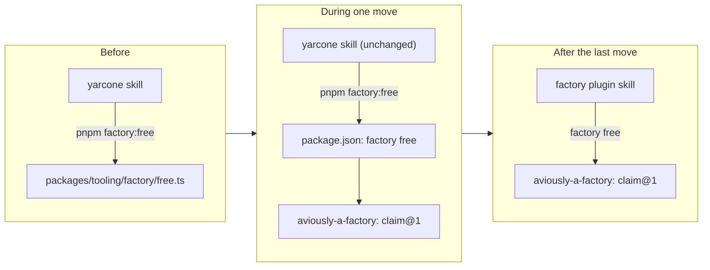
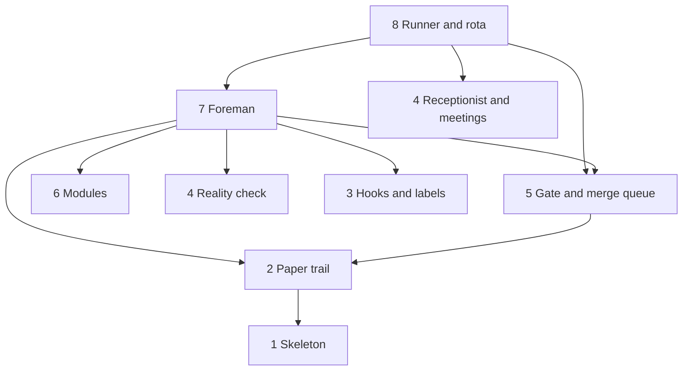

# Moving yarcone onto the factory

Swap what a name points at, one name at a time. Yarcone's skills call `pnpm factory:free`; today that runs yarcone's script, after the move it runs `factory free`. The caller never notices. Delete yarcone's copy the same day.

Move what gets called before what calls it. The foreman and the runner call everything, so they go last.

Undo a move by reverting yarcone's one PR: the old script comes back, or the pin drops to the previous factory tag.

## The order

Each row is one factory release plus one yarcone PR, landed between shifts, never while a lights-out shift holds the lock.

| # | Move | What yarcone deletes | Why here |
|---|---|---|---|
| 1 | Skeleton: `factory.config.ts`, `factory doctor` | nothing | Proves the pin and config work. Does nothing else |
| 2 | Paper trail and the File step | `factory:ledger`, `factory:digest`, `signoff-record` | Only writes records; nothing reads them back mid-shift |
| 3 | Hooks and labels | `no-hook-bypass`, `link-icons`, old label names | Leaves; label renames ship in the same PR as the skill text that names them |
| 4 | Reality check, Receptionist, meetings | `preflight`, `triager`, the decide, discuss and sweep skills | Called by a person or the runner, never by a shift |
| 5 | Gate and merge queue | `merge-queue.ts`, `queue-*`, `stages`, `review-gate`, `signoff` | Biggest code, but called only by name from the runner |
| 6 | Modules: copy desk, screenshots, mobile | `strings`, `ui-reviewer`, mobile lane pieces | The foreman calls them, so they move before it |
| 7 | Foreman: claim, build, quality control, rework | `yarcone-factory` skill, `coder`, `reviewer`, the rest of `factory:*` | Calls everything above. Whocards onboards right after |
| 8 | Runner and rota | `factory-log/runner`, `~/.yarcone-factory` | Calls the foreman, so it goes last |

An arrow means "calls". Move from the bottom up.

For AI

### One move, step by step

1. In aviously-a-factory, copy the piece over. Replace each yarcone constant (paths, machine names, label names, script names) with a `factory.config.ts` field. Its tests move with it.
2. Release a factory tag.
3. In a yarcone worktree, bump the pin. Point the `package.json` script at `factory <cmd>` (or point the skill text at the plugin's agent name). Delete yarcone's copy and its tests. Add the config fields it needs.
4. Verify locally: the moved piece's tests, `pnpm verify`, then one supervised shift on a real ticket. Push once.
5. Note the move in the yarcone memo, so the next performance review knows which step versions changed.

While iterating, link the factory checkout (`pnpm link ~/aviously/aviously-a-factory`) instead of cutting a tag per try. Merge only against a tag.

### Temporary duplication

`packages/tooling/factory/github.ts`, `config.ts` and `marks.ts` are shared by many scripts. The factory gets its own copies at move 2. Yarcone keeps its copies until its last caller moves (move 7), then deletes them. This is the one place code exists twice during the move. It is deliberate and it has an end date.

### Aliases

The `pnpm factory:*` aliases exist only during the move. After move 8, plugin skills call `factory <cmd>` directly. Delete the aliases, and the `pnpm -s factory:*` entries in the global `~/.claude/settings.json` allowlist.

### Carried over, not copied

- `factory-tick`'s feedback step asks for SKILL.md step 2, Feedback, which no longer exists (digest feedback lives in yarcone-decide step 2). The port uses the meeting step instead.
- The weekly step calls a `security:weekly` script that main doesn't have. The port either drops it or makes it a real step. It is not copied as is.

### Also sorted during the move

- About 30 memory files in `~/code/mac-setup/claude/memory/code-yarcone/` go to the factory handbook, yarcone's handbook or the suggestion box, and are deleted as they move. Personal and single-machine notes stay.
- `factory-log` becomes yarcone's paper trail repo and `signoff-runs` folds into it (move 2). Its 36 KB `learnings.md` is split into suggestion box entries and handbook rules.

